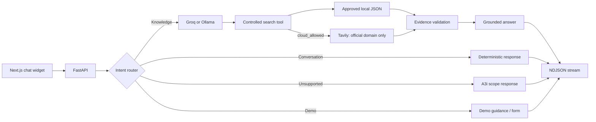

# a31-assistance


`a31-assistance` is a focused website assistant for
[A3i-Accel](https://a3i-accel.com/). It answers A3i questions from approved
content, searches only the official domain when cloud access is enabled, keeps
follow-up context, streams responses, and captures confirmed demo requests.

The project uses a **Modular Agentic RAG** design. Deterministic Python handlers
process greetings, demo requests and unsupported questions. Factual questions
follow one controlled workflow:

```text
LLM → approved search tool → evidence checks → LLM answer
```

## Features

- A3i-only scope with deterministic intent routing.
- Groq as the optional cloud model with Ollama fallback.
- Approved local JSON knowledge before external search.
- Tavily restricted to `a3i-accel.com`.
- Evidence relevance, freshness, version and numeric-claim checks.
- Concise answers with verified source links.
- Context-aware follow-ups and ambiguity clarification.
- NDJSON response streaming with safe retry events.
- Validated and idempotent SQLite demo requests.
- Local-only privacy mode that blocks Groq and Tavily.
- Rate limits, request deadlines, strict CORS and content-free telemetry.
- 64 backend regression tests and a 55-case evaluation dataset.

## Architecture



See the detailed [architecture](docs/ARCHITECTURE.md),
[implementation audit](docs/IMPLEMENTATION_AUDIT.md), and
[performance report](docs/PERFORMANCE_REPORT.md).

## Project structure

```text
Chatbot/
├── app/                         # Runtime backend package
│   ├── main.py                  # FastAPI endpoints and request lifecycle
│   ├── agent.py                 # LLM and tool orchestration
│   ├── router.py                # Four-intent deterministic router
│   ├── conversation.py          # Follow-up and clarification handling
│   ├── tools.py                 # Local and official-domain retrieval
│   ├── evidence.py              # Evidence quality checks
│   ├── knowledge.py             # Approved local knowledge search
│   ├── memory.py                # Bounded conversation memory
│   ├── leads.py                 # SQLite demo-request storage
│   ├── privacy.py               # Cloud/local privacy policy
│   ├── security.py              # CORS and rate limiting
│   ├── telemetry.py             # Content-free request metrics
│   └── config.py                # Shared project paths and environment loading
├── scripts/                     # CLI and maintenance commands
├── tests/                       # Backend regression tests
├── docs/                        # Architecture, audit and performance documents
├── knowledge/                   # Reviewed collection and legacy archive
├── data/                        # Runtime database, logs and evaluations
├── artifacts/                   # Generated review and research files
├── .env.example                 # Safe configuration template
├── requirements.txt
└── README.md
```

## Requirements

- Python 3.10 or newer.
- [Ollama](https://ollama.com/) with the model configured in `OLLAMA_MODEL`.
- Optional Groq API key for cloud inference.
- Optional Tavily API key for official-site search.
- Node.js 20 or newer for the separate Next.js frontend.

## Backend setup

From the backend project root, create a virtual environment and install the
dependencies.

### Windows PowerShell

```powershell
python -m venv .venv
.\.venv\Scripts\Activate.ps1
python -m pip install --upgrade pip
python -m pip install -r requirements.txt
Copy-Item .env.example .env
```

### macOS or Linux

```bash
python3 -m venv .venv
source .venv/bin/activate
python -m pip install --upgrade pip
python -m pip install -r requirements.txt
cp .env.example .env
```

Add real provider keys only to `.env`. The file is ignored by Git. Keep
`.env.example` as the shareable configuration template.

Start Ollama and ensure the model named by `OLLAMA_MODEL` is installed. Then run
the API:

```powershell
python -m uvicorn app.main:app --reload --host 127.0.0.1 --port 8000
```

The API is available at `http://127.0.0.1:8000`. FastAPI documentation is at
`http://127.0.0.1:8000/docs`.

## Configuration

| Variable | Default | Purpose |
|---|---|---|
| `PRIVACY_MODE` | `cloud_allowed` | Use `local_only` to block Groq and Tavily. |
| `OLLAMA_URL` | `http://127.0.0.1:11434` | Local Ollama server. |
| `OLLAMA_MODEL` | `qwen3:4b-instruct-2507-q4_K_M` | Local fallback model. |
| `GROQ_MODEL` | `openai/gpt-oss-20b` | Cloud model when Groq is configured. |
| `GROQ_API_KEY` | Empty | Enables Groq in `cloud_allowed` mode. |
| `TAVILY_API_KEY` | Empty | Enables official-site Tavily search. |
| `FRONTEND_ORIGINS` | Localhost origins | Comma-separated CORS allowlist. |
| `EVIDENCE_REVIEW_ENABLED` | `false` | Enables the optional second LLM evidence review. |
| `KNOWLEDGE_MAX_AGE_DAYS` | `180` | Maximum age of reviewed local content. |
| `CHAT_REQUEST_TIMEOUT_SECONDS` | `180` | Total chat deadline. |
| `LEAD_REQUEST_TIMEOUT_SECONDS` | `10` | Demo-request storage deadline. |
| `CHAT_RATE_LIMIT` | `30` | Chat requests allowed per rate window. |
| `LEAD_RATE_LIMIT` | `5` | Demo requests allowed per rate window. |

The remaining rate-window variables are documented in [.env.example](.env.example).

## Frontend integration

The frontend is maintained as a separate Next.js project. Configure its server
environment to point to this backend:

```dotenv
A3I_API_URL=http://127.0.0.1:8000
```

Then install and run the frontend:

```powershell
npm install
npm run dev
```

The Next.js server proxies chat and lead requests, so model and search keys stay
on the backend.

## API

### Complete chat response

`POST /chat`

```json
{
  "message": "What does A3i do?",
  "session_id": null,
  "page_path": "/"
}
```

Response:

```json
{
  "answer": "A concise evidence-based answer.",
  "session_id": "00000000-0000-0000-0000-000000000000"
}
```

### Streaming chat response

`POST /chat/stream` returns newline-delimited JSON events:

```text
{"type":"session","session_id":"..."}
{"type":"status","status":"thinking","request_id":"..."}
{"type":"delta","text":"A3i ..."}
{"type":"done"}
```

Possible event types are `session`, `status`, `delta`, `done`, and `error`.
Partial answers are not saved when a stream fails.

### Demo request

`POST /leads`

```json
{
  "name": "Visitor Name",
  "company": "Example Company",
  "need": "I want to learn about meeting automation.",
  "confirmed": true,
  "request_id": "00000000-0000-0000-0000-000000000000"
}
```

Submitting this form records a request. It does not claim that a meeting has
been booked.

## Terminal chat

Run the chatbot without the frontend:

```powershell
python -m scripts.chat_cli
```

Use `--debug` to display provider and retrieval activity:

```powershell
python -m scripts.chat_cli --debug
```

## Knowledge workflow

Fetch the official sitemap and create reviewable records:

```powershell
python -m scripts.ingest_knowledge
```

New and changed records receive `pending_review`. They cannot support answers
until someone approves them.

```powershell
python -m scripts.knowledge_admin list --status pending_review
python -m scripts.knowledge_admin show DOCUMENT_ID
python -m scripts.knowledge_admin approve DOCUMENT_ID
python -m scripts.knowledge_admin revoke DOCUMENT_ID
```

Re-ingestion preserves approval only when the content hash has not changed.

## Tests and evaluation

Run the backend regression suite:

```powershell
python -m unittest discover -s tests -v
```

Run the frontend checks from the frontend project:

```powershell
npm run typecheck
npm run build
```

Run the 55-case live evaluation:

```powershell
python -m scripts.evaluate
```

Results are written to `data/evaluations/evaluation.json`. Factual responses are
marked for human evidence review instead of being automatically declared correct.

## Privacy and security

- `local_only` prevents Groq selection and Tavily construction.
- Search results must use HTTPS and an exact official A3i hostname.
- Tool arguments reject unexpected fields.
- Answer links must match URLs returned by retrieval.
- Structured telemetry excludes messages, lead details, keys and page content.
- CORS requires explicit HTTP or HTTPS origins.
- Chat sessions, rate limits and caches have fixed in-memory bounds.

## Known limitations

- Local-only factual answers require reviewed records in `knowledge/collection.json`.
- Live search coverage depends on Tavily and the official pages it has indexed.
- Sessions, rate limits and search cache are process-local; deploy one API worker
  unless these stores are moved to shared infrastructure.
- Lead retention is manual until a final retention policy is selected.
- Local Ollama fallback speed depends on the host machine and selected model.

## Documentation

- [Architecture](docs/ARCHITECTURE.md)
- [Implementation audit](docs/IMPLEMENTATION_AUDIT.md)
- [Improvement checklist](docs/IMPROVEMENT_CHECKLIST.md)
- [Performance report](docs/PERFORMANCE_REPORT.md)
- [Change summary](docs/CHANGE_SUMMARY.md)
