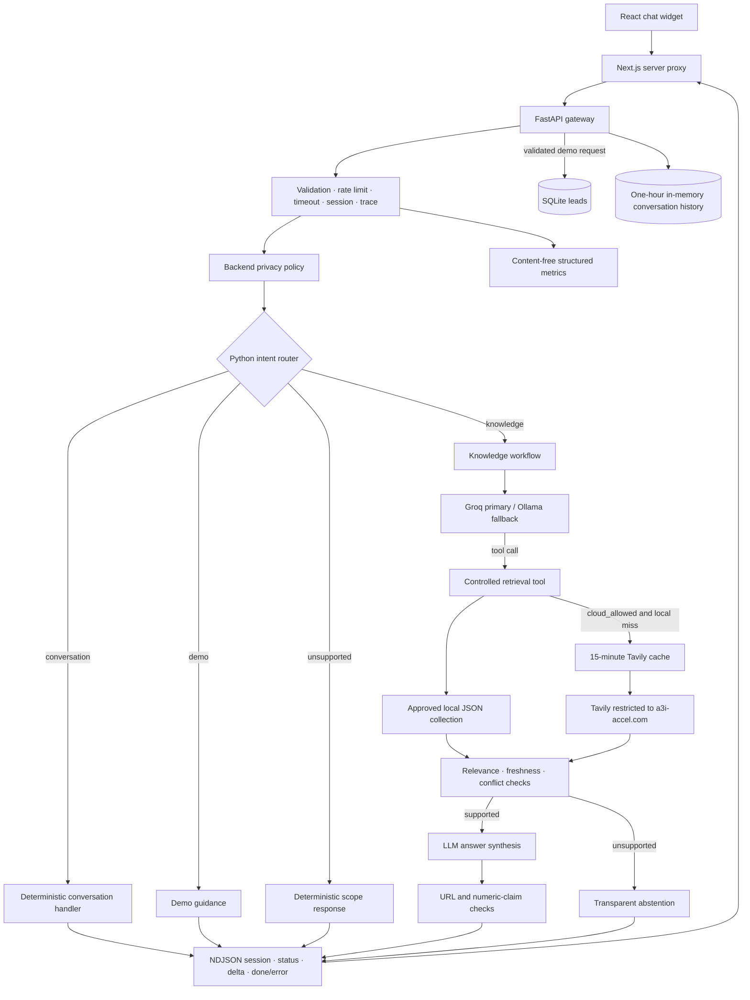

# A3i-Accel Chatbot V2 Architecture

The implemented design is a **Modular Agentic RAG Architecture** with one LLM
workflow and deterministic handlers. It does not run multiple autonomous agents.

## Privacy modes

`cloud_allowed` is the default. Groq is attempted first when configured, Ollama
is the fallback, and Tavily may search only the official A3i domain after the
approved local collection has no relevant result.

`local_only` selects Ollama and the approved local collection. The policy is
checked before provider selection and before Tavily construction, so Groq and
Tavily receive no request. If local knowledge is unavailable, the assistant
abstains.

## Knowledge lifecycle

`scripts/ingest_knowledge.py` reads the official sitemap and creates section-level JSON
records. Every new or changed record is `pending_review`. An identical record
that was already approved retains its approval and review timestamp.

`scripts/knowledge_admin.py` lists, displays, approves and revokes individual records.
Runtime retrieval reads only `approved` records with a review timestamp. Keyword
retrieval is intentionally the first implementation; vector search remains
deferred until measured relevance shows a need.

The current collection contains 61 pending records and zero approved records.
In `cloud_allowed`, these pending records are ignored and Tavily remains the
fallback. In `local_only`, factual answers will abstain until records are reviewed.

## Evidence and streaming

Retrieval checks lexical relevance, local-review freshness and conflicting
versions of the same document. Missing, irrelevant, stale or conflicting evidence
produces a short abstention. Source URLs in answers must exactly match retrieved
official URLs.

Questions involving prices, guarantees, current facts, integrations and numeric
claims are generated into a buffer. Numeric claims are released only if the value
appears in the evidence. Other answers retain normal token streaming. A second
LLM evidence review exists behind `EVIDENCE_REVIEW_ENABLED=false`; it stays off
until an evaluation demonstrates enough benefit to justify its latency.

## State and storage

- Conversation history is bounded to 12 messages, held in memory and expires
  after one hour.
- Search cache entries expire after 15 minutes and the process keeps at most 128.
- Demo requests remain in SQLite with the assignment fields `name`, `company`
  and `need`. The confirmation checkbox authorizes saving that request; it is not
  marketing consent and no meeting is claimed as booked.
- Retention and automatic deletion remain undecided, so no destructive retention
  job is enabled.

## Source boundaries

`app/main.py` owns HTTP concerns. `app/router.py` chooses an intent, and
`app/conversation.py` resolves references before retrieval. `app/agent.py` coordinates
the bounded model workflow. `app/tools.py` retrieves content, while `app/evidence.py`
decides whether that content can support an answer. Storage remains isolated in
`app/memory.py`, `app/knowledge.py` and `app/leads.py`.
